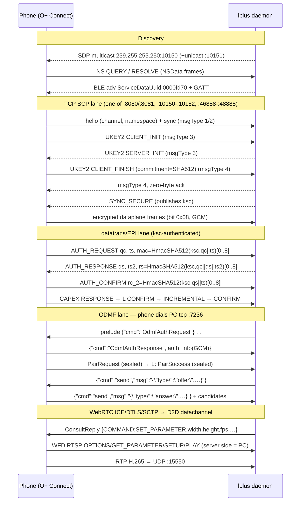

# L+ Connect ↔ phone wire protocol

What actually crosses the LAN/Bluetooth link between `lplus` and the phone's
O+ Connect stack, in session order. Every shape on this link is typed in the
[`protocol/`](../protocol) crate (`protos`, `rtsp`, `odmf`, `pair`, `appfn`);
this document explains how the lanes fit together. Java class names in
backticks are the decompiled vendor code each behavior was recovered from.

## 1. Discovery (`src/sdpd.rs`)

- SDP responder: UDP **multicast 239.255.255.250:10150** plus unicast
  **:10151**; announcements carry name, gateway and the ports the phone will
  dial later (`DSP:` = `uni_port`).
- NSD-style presence: `QUERY`/`QUERY-ACK`/`RESOLVE`/`RESOLVE-ACK * HTTP/1.1`
  frames with an `NSData` header (AccessoryFramework semantics); engines
  reject responses missing the NS key, so the exact spellings are pinned by
  tests.
- BLE (`src/ble.rs`): advertises the **FD70** packet
  (`ServiceDataUuid=0000fd70`, device-type byte) and serves GATT write/notify
  so the phone can attach after scanning. Pairing QR carries the
  `Synergy`/`HeySynergy` GSON beans (`proto::pair`).

## 2. Core handshake — SCP + UKEY2 + D2D (`src/scp.rs`, `src/ukey2.rs`, `src/d2d.rs`)

One TCP session (the phone's `TcpSocketConnectionImpl` dials one of the ports
in §7) framed as **12-byte header + protobuf**, split by `scp::split_frames`:

1. **hello / sync** (msgType 1/2): `hello_frame(channel, namespace)` mirrors
   the vendor composer; `SYNC` may be re-sent — a late msgType-1 after
   UKEY2_FINISHED is fatal (2510) on the peer, so re-sends stop on completion.
2. **UKEY2 v2** (`proto` crate — prost-generated from the vendored protos;
   cipher `P256_SHA512`, next protocol `AES_256_CBC-HMAC_SHA256`):
   the **phone is the initiator** — `CLIENT_INIT` arrives as msgType 3, we
   answer `SERVER_INIT`, `CLIENT_FINISH` (commitment = `SHA-512(envelope)`)
   arrives as msgType 4 and the ack is a msgType-4 frame with **zero bytes**
   (`l.java:108 k(f, new byte[0])`).
   HKDF salts: `"UKEY2 v1 next"` (no NUL) for the next-protocol secret,
   `"UKEY2 v1 auth\0"` (with NUL) for the auth string — the NUL mismatch is
   the trap; auth is verified as `AUTH (6-digit)` for the confirm dialog.
3. **D2DConnectionContextV1** (`src/d2d.rs`): session keys via HKDF with the
   fixed D2D salt; securemessage frames derive separate
   `ENC:2`/`SIG:1` keys from the same secret (so the C++ skips the plaintext
   tag). Signcrypt = `SecureMessage { RawHAB{Header, AES-256-CBC body},
   HMAC-SHA256 }`, GCM metadata type 1.
4. **SYNC_SECURE**: the phone's client waits ~5 s for this after
   UKEY2_FINISHED; the PC publishes the **ksc** — the *first 16 bytes of our
   server-side session key* (mirrors `um.a`'s `copyOfRange` of the
   `SecretKeySpec` in `Ukey2ClientImpl`). It is derived deterministically from
   the peer device id so it survives daemon restarts (`stable_ksc`,
   `ksc_info` on the phone).
5. From here the phone's frames set the encrypted bit (`byte[1] & 0x08`);
   the payload is GCM-sealed and must open under **encode/decode key × IV
   candidates** (proven 12-byte prefix of the ukey2 iv_spec, zero IV, counter
   IV) — the cryptor-combo sweep is in `sdpd.rs` and is how the live IV was
   established.

## 3. datatrans / EPI session (`src/sdpd.rs` epi lanes)

Authenticated entirely by the ksc from §2 (phone-side
`datatrans/security/{a.d,b.s,b.t}`):

| step | direction | content |
|---|---|---|
| `AUTH_REQUEST` (0x10) | phone → PC | `qc`(challenge) `ts`, `mac = HmacSHA512(ksc, qc‖ts_le64)[0..8]` |
| `AUTH_RESPONSE` | PC → phone | our `qs`, `ts2`, `rs = HmacSHA512(ksc, qc‖qs‖ts2_le64)[0..8]`; session key = `rs`+zeros |
| `AUTH_CONFIRM` (0x11–0x13) | phone → PC | `rc_2 = HmacSHA512(ksc, qs‖ts_le64)[0..8]` — the phone uses **its own** request `ts` here (`checkResponseParams` copies `uf/a.c` into `vf/b.e`); pinned live 2026-11-09 |
| `CAPEX` | both | RESPONSE → CONFIRM (status 0) → INCREMENTAL → CONFIRM (initial sync complete) |

## 4. ODMF lane — auth + signaling + WFD server (`src/wfd_sink.rs`)

For the *reverse* (phone-casts-to-PC) direction the **phone's
`heycast_CastOdmfEngine` dials the PC on TCP :7236** after the PC pushes
`rsp_odmf_key` over DataBus. One socket then multiplexes:

1. **Transport bus** (`proto::odmf`): prelude frames (`ODMF_PRELUDE`,
   default includes `{"cmd":"OdmfAuthRequest"}`), keepalives matched
   **tag-only** by `json_reply` (an untagged `{"a":"ping"}` is not a
   keepalive), and SDP/candidate JSON nested as
   `{"cmd":"send","msg":"<escaped inner json>"}` (`odmfs/odmfa.java
   odmfb(String)` → `onSocketMessage` CMD_SEND → `odmfc(msg)`).
2. **Identity auth** (`SigIdentityAuthHelper`): phone answers with
   `OdmfAuthResponse` whose `auth_info` is an *escaped JSON string* of
   `AuthFields{public_key, iv, encrypt_cipher, timestamp, auth_version}` —
   `encrypt_cipher` is AES-256-GCM (16-byte IV; Java `GCMParameterSpec`
   allows any IV length) over the phone's raw near-field id bytes, AAD =
   timestamp. Missing fields must be reported in validation order
   `public_key → iv → encrypt_cipher`. Then encrypted `PairRequest` →
   sealed `PairSuccess` (key order pinned by wire test).
3. **WFD RTSP server** (`proto::rtsp`, rtsp-types codec): OPTIONS,
   GET_PARAMETER capability exchange answering the exact lowercase
   `WfdParam` names (`wfd_content_protection: none`, no EDID), SETUP/PLAY
   with `wfd_client_rtp_ports: RTP/AVP/UDP;unicast <port> 0 mode=play`.
4. **WebRTC** (`src/odmf_pc.rs`): PC-side str0m agent offers through the send
   envelope, accepts the phone's answer/candidates; after DTLS/SCTP, the
   negotiated **D2D datachannel** carries the
   `ConsultReply{COMMAND:"SET_PARAMETER",width,height,fps,foldRotatesWithContent,rotatesWithContent}`
   (the phone gates screen capture until it lands and echoes `COMMAND` back;
   no ack within the gate → renegotiate, ≤5 rebuilds). Inbound
   `{"type":"offer"}` is our own direction and stays ignored.
5. **Media**: phone pushes RTP (H.265 live; H.264 depacketizer supports
   FU-A/STAP-A) to **UDP :15550**; Annex-B lands in `<out>/video_odmf.h265`.

The classic *forward* lane (`src/rtsp.rs`) is the mirror image: after the cast
trigger the **PC dials the phone's RTSP server on :7236** (retries while the
phone opens it), runs OPTIONS/DESCRIBE/SETUP/PLAY as client, advertises its
RTP port, and receives RTP the same way.

## 5. KMS / input bootstrap (`src/kms.rs`, `src/sdpd.rs`)

`spawn_command_runner` pushes a `dbs_message` `"Oplus_Cast"` /
`input_service` JSON (`kms_socket_port`, `local_ip`, `randomPwd`, `testData`)
as a DataBus frame to the phone's live **:46888** sink; the KMS socket the
phone should dial back is `KMS_PORT` (default **36863**).

## 6. WebRTC: what's standard, what's Oplus-only (`src/odmf_pc.rs`)

The phone runs a genuine libwebrtc peer — the *engine* is standards-compliant;
every deviation is Oplus' signaling shell around it. This is the split that
justifies `proto::odmf`: the SDP/ICE half needed no code beyond `str0m`,
the whole rest of that module is the non-standard glue.

**Standard (libwebrtc semantics, handled by `str0m` 0.25 +
`str0m-rust-crypto`; ICE-lite on the PC, full agent on the phone):**

- SDP is real: `m=video … udp/tls/rtp/savpf`, ICE fingerprint,
  `a=rtpmap:96 H.265/90000` (pinned in `odmf_pc` tests). The phone answers
  with a libwebrtc answer; the PC creates the OFFER like the vendor's
  `PeerConnectionClient` "PC Create OFFER" (`odmfq/odmfb.java`).
- ICE candidates arrive libwebrtc-shaped:
  `{"type":"candidate","label":0,"id":"0","candidate":"candidate:1 1 udp …"}`
  (`odmfa(IceCandidate)`), connectivity checks driven by the phone's agent.
- DTLS handshake, SCTP datachannel, SRTP/RTP receive — stock. One
  `udp.recv_from` loop demuxes with `DatagramRecv::try_from`: STUN/DTLS into
  str0m, RTP counted and fed to the `H264Depacketizer`.

**Non-standard (Oplus transport-bus inventions):**

1. **No WSS/SIP/gRPC.** Signaling is JSON lines on the raw ODMF TCP socket
   (§4) — multiplexed with RTSP, identity auth, and bus frames on the same
   connection.
2. **Double-escaped envelope.** The client only dispatches nested JSON in
   `{"cmd":"send","msg":"<inner json as escaped string>"}`
   (`odmfs/odmfa.java odmfb(String)` → `onSocketMessage` CMD_SEND →
   `odmfc(msg)`); top-level `{"type":…}` frames are ignored.
   `outbound_frames_match_captured_wire` pins the escaping — that string-in-a-
   string *is* the contract.
3. **Pre-handshake gating.** Nothing flows until pairing:
   `OdmfAuthRequest/OdmfAuthResponse` (GCM-sealed `auth_info`) and
   `PairRequest/PairSuccess` first, and the signaling queue only flushes on
   `onPairSuccess`. Stock WebRTC has no such gate.
4. **Inverted roles + datachannel capture gate.** The PC (receiver) creates
   the offer; capture does not start at DTLS success but only after the
   `ConsultReply{COMMAND:"SET_PARAMETER",width,height,fps,…}` lands on the
   negotiated channel — the phone echoes `COMMAND` back as ack
   (`q2/i.java p(b)`). "ICE connected but no consult ack/RTP" is a real
   failure mode: renegotiate, ≤5 rebuilds (`consult_gate_open`).
5. **RTSP beside it.** WFD capability exchange (OPTIONS/GET_PARAMETER with
   the `wfd_*` names, SETUP/PLAY) rides the same socket à la Miracast —
   never mixed in stock WebRTC apps.

## 7. AppFunction control (`src/steer.rs`, `proto::appfn`)

Device-state control goes over adb `app_function` against
`OPSynergyAppFunction` (`setDeviceStateItem`); the CLI stdout envelope wraps
every field in an array — only `androidAppfunctionsReturnValue[0]`'s
`isSuccessful[0]`/`failureReason[0]` decide (a `null` verdict is *not*
success).

## 8. Streams opened by the daemon (summary)

| transport | port(s) | who dials | purpose |
|---|---|---|---|
| UDP multicast | 239.255.255.250:**10150** | — (join) | SDP announcements |
| UDP unicast | **10151** | phone | SDP unicast |
| TCP | **8080/8081** (`csp`, +1) | phone | SCP channel |
| TCP | **10150,10151,10152** | phone | SCP/dial ports (socketPort, +1) |
| TCP | **46888 / 47888 / 48888** | phone | datatrans dial list (`ee.a.f6613c`; refusal → error -1110) |
| TCP | **:46888** (phone side) | PC | KMS/DataBus input bootstrap sink |
| TCP | **7236** (`ODMF_LISTEN`) | phone | ODMF lane: RTSP server + bus + auth + signaling |
| TCP | phone **:7236** | PC | classic WFD RTSP client lane (`src/rtsp.rs`) |
| UDP | **15550** (`ODMF_RTP_PORT`) | phone | RTP (H.265/H.264) |
| UDP BLE | FD70 adv + GATT | phone | near-field attach |
| TCP | loopback **1421** | control clients | contract server: gRPC (tonic, HTTP/2) — generated stubs for `service Lplusd`, all strictly typed (Ping, ListDevices, Connect/Disconnect/RemoveDevice, GetHostName/SetHostName, GetPairedDevices, GetLocalDeviceId, EnsureRunning, GetCloudBind, SidecarStatus, PollEvents, Status, CastPush/OdmfStart/KmsBootstrap, SinkList/InjectFrame, RequestLive/TakeFrame) |
| TCP | loopback `LPLUS_EVENTS_PORT` | dev | NDJSON presence bus |

Opt-in env: `ODMF_SINK=1`, `ODMF_LISTEN`, `ODMF_RTP_PORT`, `ODMF_OUT`,
`ODMF_RESPOND`, `ODMF_PRELUDE`, `ODMF_AUTH_FILE`/`ODMF_PRIV_PEM`,
`KMS_PORT`, `KMS_PWD`, `ODMF_SINK_W/H/FPS`, `LPLUS_BACKEND`.
